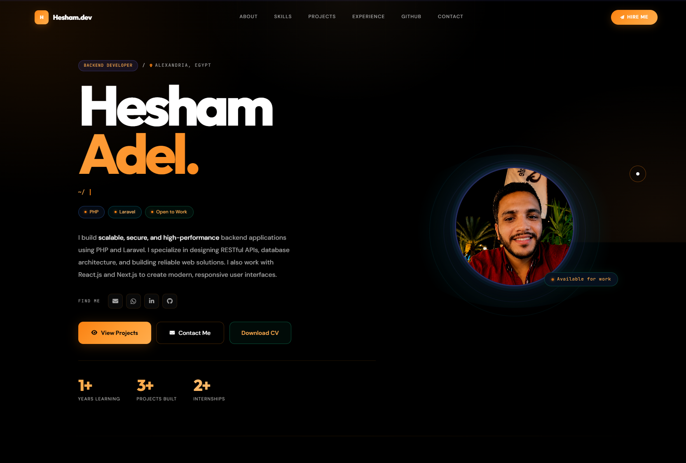

# HeshamAdel | Personal Portfolio


[](https://github.com/heshamadel1/portfolio/actions/workflows/deploy.yml)


---

Welcome to my personal portfolio repository!
This project is a personal portfolio website designed to showcase my skills, projects, and experience as a developer.

🚀 [**Visit My Portfolio →**](https://heshamadel1.github.io/portfolio/) | 🖼️ [**View Portfolio Screenshot**](./screenshots/full-portfolio-preview.png)

---

## 📸 Website Preview

<p align="center">

</p>

---

## 🚀 Built With

- ⚡ **Vite**
- 📄 **Pug**
- 🌐 **HTML5**
- 🎨 **SCSS (Sass)**
- ⚙️ **JavaScript**

---

## ✨ Features

- Clean and modern design
- Fully responsive layout
- Optimized assets
- Organized project structure
- Fast development and production build

---

## 🛠️ Getting Started

Follow these steps to run the project locally.

### 1. Clone the repository

```bash
git clone https://github.com/heshamadel1/portfolio.git
cd portfolio
```

### 2. Install dependencies

```bash
npm install
```

### 3. Start the development server

```bash
npm run dev
```

### 4. Build for production

```bash
npm run build
```

---

## 📄 License

This project is licensed under the [MIT License](LICENSE).

Feel free to explore, use, modify, and learn from this project while keeping the original copyright and license notice.

---

## 👨‍💻 Author

**Hesham Adel** ❤️

- GitHub: [@HeshamAdel1](https://github.com/HeshamAdel1)
- Portfolio: [Live Website](https://heshamadel1.github.io/portfolio/)

---
